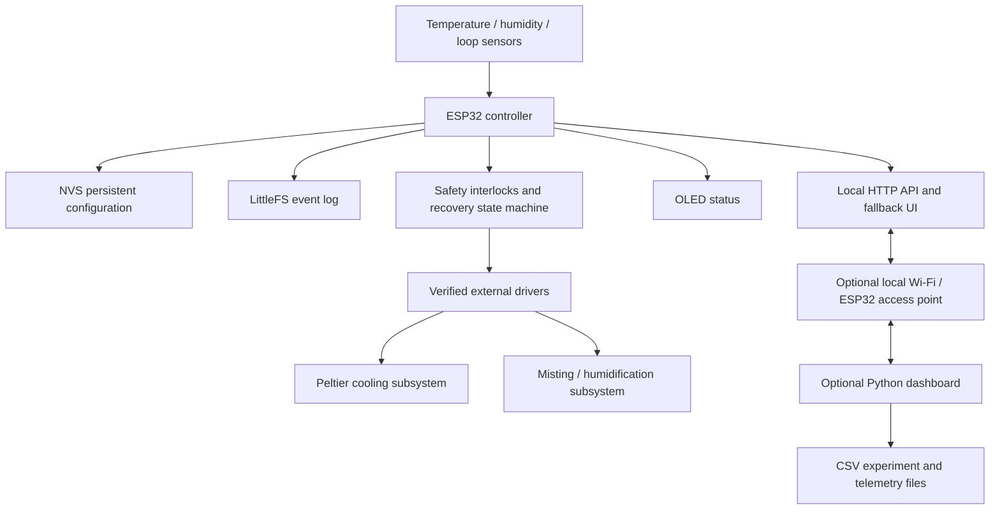

# SAFFRON-AERO

**Offline-first aeroponic saffron cultivation with persistent, phase-aware ESP32 climate control**

[](https://www.espressif.com/en/products/socs/esp32)
[](https://docs.platformio.org/en/latest/frameworks/arduino.html)
[](https://platformio.org/)
[](https://www.python.org/)
[](https://flask.palletsprojects.com/)
[](LICENSE)

## Current Arduino IDE firmware

For the standalone Wi-Fi/OLED build, start here:

- **[Open the Arduino IDE sketch](firmware/arduino_ide_standalone/SAFFRON_AERO_ESP32_WIFI_OLED_FIX/SAFFRON_AERO_ESP32_WIFI_OLED_FIX.ino)**
- [Arduino IDE setup, libraries, and dashboard instructions](firmware/arduino_ide_standalone/SAFFRON_AERO_ESP32_WIFI_OLED_FIX/README.md)
- [Standalone wiring/pin map](hardware/arduino_ide_standalone_pin_map.csv)

This sketch is maintained separately from the safety-locked PlatformIO reference firmware in `firmware/esp32_controller/`. **Do not mix their pin assignments or assume their safety behavior is identical.**

| Measurement / control | Standalone sketch |
|---|---|
| **Chamber air temperature + RH** | DHT22 on GPIO 16 — primary temperature feedback for automatic control |
| **Peltier cold-plate temperature** | DS18B20 on GPIO 4 — separate cold-plate reading/cutoff, not chamber temperature |
| **Peltier driver control** | PWM signal on GPIO 25; connect only to a verified external driver |
| **Humidifier relay control** | GPIO 26; verify relay polarity and electrical isolation |
| **OLED** | SSD1306 I²C, SDA 21 / SCL 22 |
| **Target chamber temperature** | Editable per phase in the standalone dashboard |
| **Estimated achievable chamber temperature** | **Not implemented yet.** No calibrated estimate is shown; a target is not proof the chamber can reach it. |

The uploaded standalone sketch is preserved as supplied. It has not been newly compiled or re-tested on physical hardware as part of this repository update. Review the standalone setup guide and safety limitations before connecting high-current loads.

---

> **Safety status:** this is an experimental prototype and software reference implementation, not a certified agricultural appliance. The firmware defaults to disabling real Peltier and misting outputs until the driver topology, pump/fan control, flow switch, hot-side temperature sensor, reservoir switch, wiring, fuses and safety response have been reviewed and explicitly configured. Do not connect a Peltier module to an ESP32 GPIO.

## What this project investigates

The project investigates whether a small insulated chamber can reduce exposure of an experimental saffron corm batch to selected outdoor temperature and humidity fluctuations, while recording environmental conditions and operator observations. It combines a local ESP32 controller, DHT22 and DS18B20 measurements, a six-phase cultivation profile, a local web API, optional Wi-Fi access-point operation, a small OLED, and a laptop dashboard for visualisation and research logging.

It addresses **controlled-environment cultivation**, not all weather-related agricultural problems. It does not itself produce forecasts, deliver location-specific field advisories, or prove that a farmer's field is climate-resilient. Optional weather/advisory integration is future work and is deliberately outside the core control dependency.

## System at a glance



The ESP32 is the source of truth for saved device configuration and live control state. The laptop, browser, Python process, router and internet are not required for the firmware control loop. The supplied firmware continues sensing and making control decisions with no dashboard client. **A complete power outage still stops regulation**; persistence only supports recovery after power returns.

## Known hardware and assumptions

**Firmware variants:** The main reference firmware is the safety-locked PlatformIO project in `firmware/esp32_controller/`. A separate, user-supplied Arduino IDE sketch is now preserved at `firmware/arduino_ide_standalone/SAFFRON_AERO_ESP32_WIFI_OLED_FIX/`. These are different implementations with different control and safety behavior; do not mix their pin maps or treat one as a drop-in replacement for the other.

| Item | Project assumption | Status / important limit |
|---|---|---|
| Chamber | Approximately 2 ft × 1.5 ft × 1 ft, EPS/thermocol with about 3 cm insulation | Actual internal dimensions and thermal bridges must be measured |
| Viewing panel | Insulated glass section | May create solar heat gain and local temperature gradients |
| Plant material | About 25 Kashmiri saffron corms; stated mass 17–20 g each | Count, health and actual mass must be logged |
| Controller | Generic 38-pin ESP32 development board | Board variant/pinout must be confirmed |
| Air sensor | DHT22/AM2302, proposed GPIO 16 | Verify pull-up, cable and placement |
| Temperature sensor | DS18B20, proposed GPIO 4 | Firmware treats index 0 as the cooling-loop sensor; verify placement/address |
| Cooling | Two TEC1-12715 modules and a liquid cooling loop | **No high-current output is enabled by default.** Driver, pump, flow, fan, hot-side limit and wiring require inspection |
| Misting | Ultrasonic mist maker/atomizer on a switched driver, proposed GPIO 27 | Air humidification is not proof of aeroponic root coverage |
| OLED | I²C SSD1306, SDA 21 / SCL 22 | Verify voltage, address and wiring |
| Optional safety inputs | Flow switch, reservoir-level switch, hot-side DS18B20, fan and pump outputs | Unconfigured by default; firmware blocks the related high-current load if required feedback is absent |

Do not infer that a 650 W computer PSU makes every proposed load safe. Verify each rail, current limit, protection device, connector, wire gauge, grounding arrangement, cooling capacity and thermal path.

## Power-failure recovery: what is implemented

- Configuration is serialised and written into alternating NVS slots with a schema version, monotonically increasing revision, CRC-32 and read-back validation. The newest valid slot is selected at startup; an invalid update should leave the older valid slot available.
- The active phase and per-phase profiles are saved when an operator commits a change, not rewritten every loop.
- The boot state machine restores saved configuration before accepting automatic-control decisions.
- Sensors must produce fresh, plausible measurements. A stale value, disconnected-sensor sentinel or DHT failure is not substituted with a number.
- The saved automatic mode is not sufficient to power a load. The cooling pathway checks the external-driver configuration, pump/fan outputs, flow switch and hot-side temperature before permitting Peltier commands. Misting requires a verified driver, reservoir feedback and valid humidity measurement.
- A previous manual mode does not restore an old forced-output command after reboot. It returns with outputs off and requires a fresh, timed operator command.
- Emergency-stop and detected flow/thermal faults are latched in saved configuration and require intentional fault clearance.
- Events are appended to a bounded LittleFS CSV log where the filesystem is available. The log records boot-relative time, not an invented wall-clock timestamp.

The first boot deliberately requires an explicit commissioning action because no saved configuration exists. It does not silently claim that a compiled-in `ACTIVE_PHASE` from a previous sketch was migrated. A first-time configuration uses provisional profiles that must be checked against the research notes and calibrated in the actual chamber.

## Quick start: dashboard simulation

Simulation is the safest first run and does not require hardware.

1. Install Python 3.11 or newer.
2. Open a terminal in `SAFFRON-AERO/dashboard/`.
3. Create and activate a virtual environment (optional but recommended).
4. Install dependencies and launch the explicit simulator:

   ```bash
   python -m venv .venv
   # Windows PowerShell
   .\.venv\Scripts\Activate.ps1
   # macOS / Linux
   # source .venv/bin/activate
   pip install -r requirements.txt
   python app.py --simulate
   ```

5. Open `http://127.0.0.1:5000`.

A banner marks synthetic readings. Phase/profile edits affect only simulator state, not NVS or hardware. The mathematical signal is a UI/test fixture, not a thermal model and not evidence of crop performance.

## Quick start: connect the optional dashboard to the ESP32

1. Inspect `firmware/esp32_controller/include/config.h`. Change `NetworkConfig::AP_PASSWORD` and `NetworkConfig::API_KEY` to strong, unique local values. Do not commit real credentials to a public repository.
2. Build and flash the firmware (steps below). By default the access point SSID is `SAFFRON-AERO`; connect a laptop to it and note the ESP32 IP printed to Serial (commonly `192.168.4.1` when AP startup succeeds).
3. In Windows PowerShell set the dashboard environment variables, adjusting the URL and key to match the firmware:

   ```powershell
   $env:SAFFRON_DEVICE_URL = "http://192.168.4.1"
   $env:SAFFRON_API_KEY = "your-same-random-api-key"
   python app.py
   ```

4. Open `http://127.0.0.1:5000`. The dashboard in device mode never silently falls back to simulated values; an unavailable controller is reported as an error.
5. A new device reports `CONFIG_RECOVERY_REQUIRED`. Open the ESP32 local fallback page, enter the API key from your private `config.h` into the password field (kept only for that browser tab), then use the explicit commissioning action to save initial provisional profiles. This does **not** enable Peltier or misting loads.

You can omit the Python dashboard entirely and open the ESP32's local fallback page at `http://192.168.4.1` after connecting to its access point. The dashboard is an optional display/client; the firmware loop is local.

## Alternative firmware: Arduino IDE standalone sketch

The separate sketch at [`firmware/arduino_ide_standalone/SAFFRON_AERO_ESP32_WIFI_OLED_FIX/SAFFRON_AERO_ESP32_WIFI_OLED_FIX.ino`](firmware/arduino_ide_standalone/SAFFRON_AERO_ESP32_WIFI_OLED_FIX/SAFFRON_AERO_ESP32_WIFI_OLED_FIX.ino) preserves the Wi-Fi/OLED version supplied for the working standalone setup. Follow the dedicated [Arduino IDE README](firmware/arduino_ide_standalone/SAFFRON_AERO_ESP32_WIFI_OLED_FIX/README.md) for libraries, wiring, network access, and limitations.

Important differences from the main PlatformIO firmware:

- DHT22 on GPIO 16 is the **chamber-air temperature and relative-humidity sensor**. The automatic temperature controller reads this chamber-air measurement.
- DS18B20 on GPIO 4 is treated as the **Peltier cold-plate probe**. It is used for the cold-plate cutoff, not as chamber temperature.
- The standalone sketch drives a Peltier driver PWM signal on GPIO 25 and a humidifier relay on GPIO 26. These are driver-control signals, not power outputs; the electrical driver and load must be verified before connection.
- The standalone sketch does **not** currently calculate, display, or let the user adjust an estimated achievable chamber temperature. It has no ambient-temperature input or calibrated thermal model. Do not mistake the target temperature for an achievable-temperature estimate.
- The main PlatformIO firmware's default high-current outputs remain disabled until its own commissioning requirements are met. This behavior must not be assumed to apply to the standalone sketch.

The sketch is copied as supplied. This repository update does not claim a fresh firmware compile or physical hardware/safety validation.

## Build and flash the ESP32 firmware

Install [PlatformIO Core](https://docs.platformio.org/en/latest/core/installation/index.html) or the VS Code PlatformIO extension. Open the folder `firmware/esp32_controller/` as the PlatformIO project. Connect the ESP32 and set the actual serial port in `platformio.ini` or through the IDE's device selection; do not assume `COM14` or any other computer-specific port.

```bash
pio run
pio device list
pio run -t upload --upload-port COM14
pio device monitor --port COM14 --baud 115200
```

Replace `COM14` with the port actually shown by the tool. The ESP32 board package and pinned libraries are declared in `platformio.ini`; a first build downloads them. A connected board is not required to run the Python unit tests, and a successful software build would not prove hardware safety.

## What must happen before real Peltier operation

**Do not simply set the `*_VERIFIED` constants to `true`.** First inspect and document the exact circuit. Verify the module current, power supply, switching device and control interface; test the pump, fans and flow switch separately; identify both DS18B20 probes by address and physical location; confirm the hot-side temperature limit from actual module/heatsink ratings; verify electrical protection and splash isolation; and implement a safe response to loss of flow or overheating. Then update `config.h`, audit the pin map, and run a supervised no-corm commissioning protocol. The stock build also sets the three high-current load-command GPIO assignments to `-1`, so it does not even configure proposed GPIO25/26/27 as load outputs. Assign those pins only after verifying that `LOW` is the actual safe electrical state for the chosen driver. The shipped defaults intentionally keep these outputs disabled.

For a safe development progression: simulation → firmware build → sensor-only bench test → driver-input test with loads disconnected → pump/fan/flow interlock test → supervised thermal test → small corm experiment. Do not skip levels.

## Repository map

- `firmware/esp32_controller/` — ESP32 Arduino/PlatformIO firmware and configuration.
- `firmware/arduino_ide_standalone/SAFFRON_AERO_ESP32_WIFI_OLED_FIX/` — standalone Arduino IDE sketch and setup guide, kept separate from the safety-locked reference firmware.
- `hardware/arduino_ide_standalone_pin_map.csv` — pin map for the standalone sketch; do not confuse it with the main firmware's `hardware/pin_map.csv`.
- `dashboard/` — one Flask dashboard with explicit simulator mode, device mode, local charts and CSV export.
- `docs/saffron_growth_environment.md` — stage-specific research summary and provisional profiles.
- `docs/problem_solution_report.md` — research and engineering report; see its actual word count and the validation report.
- `docs/hardware_and_wiring.md`, `docs/electrical_safety.md`, `docs/installation_guide.md` — wiring assumptions and commissioning cautions.
- `shared/protocol.md` — local HTTP API contract.
- `hardware/` — pin map, bill of materials and uncertain-connection register.
- `tests/` — automated Python tests for persistence/recovery/control invariants and dashboard API behaviour.
- `data/` — sample data and the dashboard's locally written CSV files at runtime.
- `BUILD_AND_VALIDATION_REPORT.md` — exact checks completed in the delivery environment and outstanding limitations.

## Glossary

- **Corm:** the underground storage and propagation organ of saffron.
- **Floral induction:** physiological transition in which the corm develops the capacity to form flowers; it is not the same as visible flowering.
- **Aeroponics:** roots are suspended and supplied with a nutrient/moisture mist rather than a conventional soil bed. A humidifier in chamber air does not automatically create an aeroponic root zone.
- **NVS:** non-volatile storage on the ESP32 used for compact configuration that persists across restart and power loss.
- **CRC:** cyclic redundancy check used here to detect accidental corruption of stored configuration; it is not cryptographic authentication.
- **Hysteresis:** separate turn-on and turn-off thresholds that reduce rapid switching near a target.
- **Interlock:** a condition that must be satisfied before a particular output is allowed.
- **Commanded output:** the GPIO state requested by firmware; it is not verified electrical current or mechanical operation.
- **Simulation:** synthetic data/state used to test the interface. It is not a physical measurement or crop result.

## Testing

From the repository root:

```bash
python -m unittest discover -s tests -v
python tools/validate_project.py
```

These tests exercise the portable Python reference model and dashboard endpoints, not the ESP32 electrical system. See `docs/testing_and_validation.md` for limits. Manual hardware checks and biological trials remain outstanding.

## Research and scientific honesty

The phase names organise data entry; saffron phenology is not reducible to a timer. Published temperature sequences vary by cultivation system and study, and results from soil-grown or greenhouse saffron cannot be directly claimed as validated aeroponic setpoints. Every profile is marked provisional until the specific chamber and corm batch are experimentally assessed. Research links and citation metadata are collected in `docs/research_and_references.md` and `docs/references.bib`.

## License and contributions

The code and documentation are released under the MIT License, except for third-party dependencies which keep their own licenses. See `CONTRIBUTING.md`. Do not submit credentials, unverified yield claims, or unsafe wiring as a working feature.


---

## Maintenance & Audit

- **Audit date:** 10 November 2026
- **Documentation status:** README reviewed and audit record added on this date.
- **Scope and evidence:** This is a documentation-level maintenance pass. It does not establish that source code compiles, dependencies are current, security has been tested, or runtime behavior has been verified.
- **Code and tests:** No new functional code changes or test results are claimed by this README update. Run project-specific build, test, and security checks before relying on the project.
- **Maintenance baseline:** Documentation status recorded through 10 November 2026; revisit setup instructions, dependencies, security, known limitations, and tests when the project changes.
