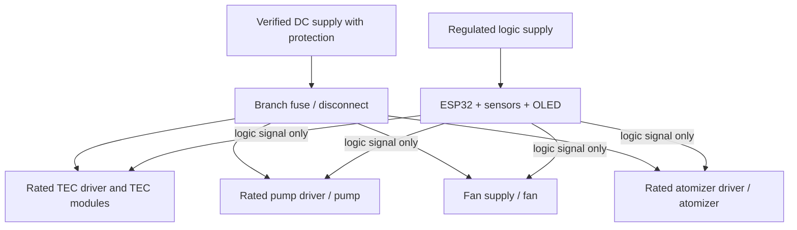

# Hardware and wiring assumptions

## Pin map

| Signal | Proposed GPIO | Firmware default | Electrical requirement / verification |
|---|---:|---|---|
| DS18B20 1-Wire data | 4 | Enabled for readings | Correct pull-up to sensor logic supply; verify sensor location. Do not immerse an unsealed probe or place it where it can short circuitry. |
| DHT22 data | 16 | Enabled for readings | Confirm sensor board voltage, pull-up and cable length; protect from condensation. |
| Peltier driver enable 1 | 25 | Output LOW; driver unverified | ESP32 pin connects only to a compatible driver input. Never to a TEC power lead. Confirm active polarity and driver topology. |
| Peltier driver enable 2 | 26 | Output LOW; one logical cooling demand | Both are commanded together. Independent control is not claimed. |
| Misting driver enable | 27 | Output LOW; driver unverified | Rated MOSFET/relay module, appropriate load supply and inductive-load protection where relevant. Confirm whether it humidifies air or wets roots. |
| OLED SDA | 21 | I²C | Verify board logic level, address and pull-ups. |
| OLED SCL | 22 | I²C | Verify board logic level and wiring. |
| Coolant pump enable | Disabled (`-1`) | Not configured | Assign only after driver, current, start behaviour and external protection are inspected. |
| Hot-side fan enable | Disabled (`-1`) | Not configured | Assign only after driver polarity and fan current are verified. |
| Flow switch | Disabled (`-1`) | Not configured | Firmware expects active HIGH while flow is proven. Adapt only after testing the actual switch. |
| Reservoir-level input | Disabled (`-1`) | Not configured | Firmware expects active HIGH while reservoir level is safe. The exact switch and polarity must be bench-tested. |
| Hot-side DS18B20 index | Disabled (`-1`) | Not configured | Do not set by index alone until the 1-Wire addresses and physical locations are mapped. Must be distinct from the coolant-loop probe (index 0). |
| Light sensor | Disabled (`-1`) | “NOT INSTALLED” | Sensor type, calibration and spectral response are unspecified. |

Pin values are centralised in `firmware/esp32_controller/include/config.h`. These are candidate assignments, not an as-built wiring diagram. Verify the precise generic 38-pin ESP32 variant, boot strapping constraints, voltage levels and peripheral conflicts before finalising the table.

## Recommended power partition

The diagram is conceptual. It does not specify final wire sizes, grounding, connector choice, driver module, isolation or exact fuses because those depend on the unidentified physical components. Each high-current load should have a correctly rated supply branch, a suitable protective device and a safe disconnect. Keep liquid pathways, reservoirs and condensation-prone areas physically separated from mains and exposed conductors. Establish a common signal reference only where the verified driver interface requires it; do not casually tie isolated supplies together.

## Peltier thermal path

A TEC consumes electrical power and pumps heat from its cold side to its hot side; the hot-side assembly must reject both the transferred heat and the TEC's input power. Two modules can impose a much larger heat-rejection requirement than one. A cold-side water block does not replace hot-side cooling. Confirm compression/contact pressure, thermal interface material, heat-sink rating, coolant flow, radiator capacity, pump curve and fan performance. Condensation may form on cold surfaces; protect adjacent electronics and wiring.

The firmware uses a shared logical on/off cooling request for both TEC drivers. It does not expose a percent-to-cooling-capacity promise. It does not prove that the modules are electrically independent or that the actual module current equals the GPIO command.

## 12 V pump, radiator and fans

Confirm rated voltage, stall/start current, connector, polarity, blocked-rotor behaviour, and compatibility with the switching device. A pump relay command is not flow proof. The firmware requires a separate configured flow switch for the Peltier path. The switch polarity is active HIGH in this code, which must be adjusted if the real sensor operates differently. Do not set `FLOW_SENSOR_VERIFIED` true until loss-of-flow and startup tests demonstrate the switch behaves correctly.

## Misting arrangement

An ultrasonic mist maker is not necessarily a root-zone aeroponic nozzle. Document its reservoir, atomisation method, droplet delivery, coverage, drainage, sanitation and water-level interlock. The current software profile contains a humidity hysteresis plus mist pulse/rest values. It is a guarded prototype controller, not a validated aeroponic recipe. If used to deliver moisture to roots, implement and validate a distinct root-zone recipe rather than using chamber RH as the only control variable.

## Driver verification record

Before changing any `*_VERIFIED` constant, record: manufacturer/model, datasheet, logic input voltage/polarity, continuous and peak current, thermal limits, required switching frequency or on/off restrictions, fuse/overcurrent protection, wiring diagram revision, hardware test date, emergency-stop test result and reviewer. The code defaults to “not verified” deliberately.

## Standalone Arduino IDE sketch — separate pin map

The table above documents the main `firmware/esp32_controller/` safety-locked PlatformIO build. Do not apply that table to the separate standalone sketch at `firmware/arduino_ide_standalone/SAFFRON_AERO_ESP32_WIFI_OLED_FIX/`.

The standalone sketch has its own [pin map](../hardware/arduino_ide_standalone_pin_map.csv). Its DHT22 on GPIO 16 supplies the chamber-air temperature/RH reading used by the automatic control loop. Its DS18B20 on GPIO 4 is treated as the Peltier cold-plate probe and is used for the cold-plate cutoff. This is intentionally distinct from chamber temperature.

The standalone implementation uses GPIO 25 as a Peltier driver PWM control and GPIO 26 as a humidifier relay control (active HIGH by default). It does not include the main firmware's compile-time high-current output lockout, and its cold-plate measurement is not a hot-side temperature safety measurement. Confirm the whole external driver/power/cooling arrangement before applying real loads.

The standalone dashboard does not currently show or calculate an achievable chamber temperature. It has no ambient measurement or calibrated thermal model. Its target temperature is an editable request, not a claim about the chamber's minimum achievable temperature.
