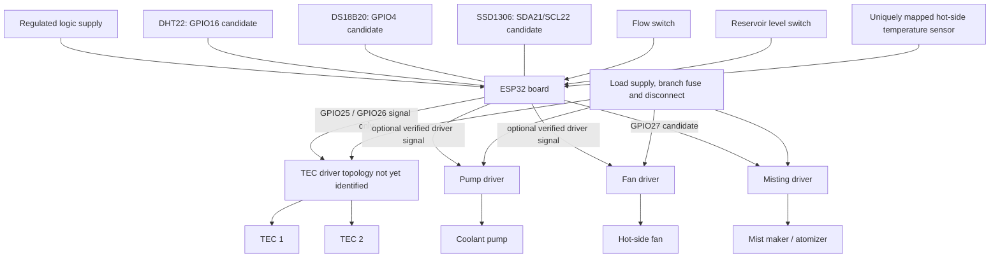

# Wiring diagram source / unresolved hardware assumptions

The physical driver topology is unknown; therefore this repository intentionally does not invent a detailed point-to-point schematic for the high-current section. The diagram below is a **block diagram only**. Draw the final schematic from actual module part numbers and verified datasheets.

## Items that block drawing a safe final schematic

- Exact Peltier driver or module: part number, logic input, active polarity, current rating, switching frequency, isolation and thermal limits.
- Exact TEC electrical arrangement and whether the modules have one shared or separate driver channels.
- Exact PSU/rail and connector; rated output current, overcurrent response, grounding and connector distribution.
- Pump and fan models, startup/stall current, driver requirements and physical routing.
- Flow switch model and electrical state for no-flow / flow / disconnected wire.
- Reservoir-level switch model and safe/fault/disconnected state.
- DS18B20 ROM addresses and exact physical attachment points.
- Required fuse ratings, wire sizes, connectors, branch protection, physical E-stop and condensation/water isolation.

The default firmware pins 25/26/27 must connect only to a compatible driver input, never directly to a Peltier module or high-current atomizer. Keep all outputs disabled until the final schematic is reviewed and the actual bench test passes.
